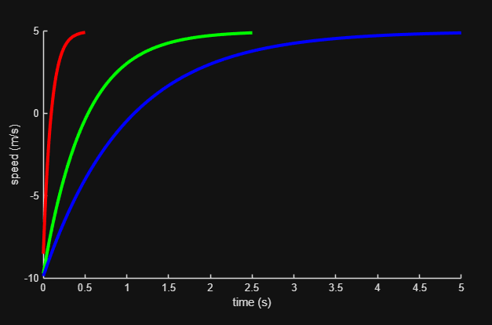
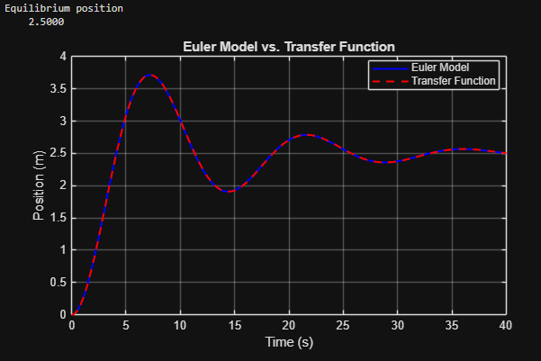
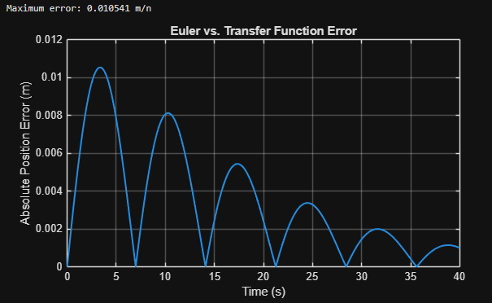

# Control-Systems-Lab

## Lab Status: In Progress

This learning lab explores the modeling and simulation of dynamic systems using MATLAB. Current work includes first-order system responses, spring-mass-damper modeling, numerical integration using Euler methods, and comparisons with continuous-time transfer-function simulations.

The next phase will focus on poles, system stability, and feedback control.

**Goal**: build a stronger understanding of control systems through mathematical modeling, simulation, and experimentation.

## First-Order Speed Response Simulation

This project is simulating a first order ODE system designed to showcase a system response to meeting a user desired speed. The system response was produced using a forward Euler integration. Due to the use of such a numerical method, it’s an approximation of the system’s exact continuous-time response. The purpose of this simple simulation is to understand the effects of factors like that delta time (dt) and the time constant (tau) and how they affect a system’s response.

### Mathematical Model

The system is described by the following first-order differential equation:

```math
\frac{dx}{dt} = \frac{u-x}{\tau}
```

Where:

`u` is the desired speed

`x` is the current speed

`tau` is the time constant

The time constant determines how quickly the system approaches its desired speed. A smaller time constant produces a faster response, while a larger time constant produces a slower response.

### Implementation

The simulation uses Forward Euler integration to approximate the speed response over discrete time steps.

Numerical update equation:

```math
x_{n+1} = x_n + \frac{u - x_n}{\tau} * dt
```
This was implemented in MATLAB using:

```matlab
deriv = (u - x) / tau;
x = x + deriv * dt;
```

At each iteration, the current rate of change is calculated using the difference between the desired and current speeds. This rate is assumed constant over the time step and used to estimate the next speed.

The updated speed values are stored in an array and plotted against time.

**The project consists of two MATLAB files:**

compare_sim.m – Runs experiments with different time constants and plots the results.

simulateFirstOrderSpeed.m – Numerically calculates the speed response using Forward Euler integration.

### Experiment – Effect of the Time Constant

The simulation was run three times with the same initial parameters with the exception being the value of the time constant itself.

(RED) => `tau` = 0.1;

(GREEN) => `tau` = 0.5;

(BLUE) => `tau` = 1;

### Results

<p align="center">
  
</p>

As shown by the fact that the red simulation reached the desired value of 5 m/s the fastest, while the blue simulation reached it the latest, it’s confirmed that a smaller time constant produces a faster response.

### Key Takeaways

A smaller time constant produces a faster response. I also noticed that the reciprocal of the time constant scales the error term, which resembles how proportional gain affects a controller's response.  Another subtly that I learned was that this system is only an approximation to which its accuracy varies on the magnitude of the time steps. As for each time step the system is assuming a constant rate of change over each time step when in reality that may not be the case.

## Semi-implicit Euler vs Transfer Function (Spring Mass Damper Simulation)

This project is simulating a second order differential equation of a spring mass damper system and plotting its system response using two different methods. One being a semi-implicit Euler integration and the second being a transfer function developed using MATLAB’s `tf` function. The purpose of this simulation is to utilize two different simulation methods and compare their system response in terms of mass position.

### Mathematical Model

The system is described by Newton’s Second Law (F = ma).

```matlab
a = (u - (b*v) - (k*p))/m
```
Where:

`u` is the constantly applied force

`a` is the acceleration

`v` is the velocity

`p` is the the position

`b` is the damping coefficient 

`k` is the spring constant

`m` is the mass

### Implementation

**Semi-implicit Euler integration** => It first calculates the acceleration before updating the mass’s velocity which in turn updates the mass’s position during a time step:

This was implemented in MATLAB using:  

```matlab
p_values(num) = p;
a = (u - (b*v) - (k*p))/m;
v = v + a * dt;
p = p + v * dt;
```

At each iteration, the current rate of change of acceleration is calculated using the rearranged summation of forces equation with updated parameters of velocity and position in tandem with the constant physical parameters like coefficients, applied force, and mass. 

The updated position values are stored in an array and outputted by the function.

<ins>Please note that this is Semi-Implicit Euler, not Forward Euler, which essentially means instead of using the initial value of velocity to calculate the position change this simulation will calculate the new acceleration, update the velocity to use its end-of-timestep value to update its position.</ins>

**Transfer Function** => The transfer function is an expression that relates the desired output to an input in the frequency domain. 

This is done by taking the summation of forces equation and using the Laplace Transform with zero initial conditions to relate all the forces in terms of the output of position in an algebraic form as shown below:
```math
F(t) = mx’’t + bx’t + kx
```
```math
F(s) = ms^2X(s) + bsX(s) + kX(s)
```
```math
G(s) = \frac{X(s)}{F(s)} = \frac{1}{(ms^2 + bs + k)}
```

This was implemented in MATLAB using:  

```matlab
m = 2;
b = 0.4;
k = 0.4;

G = tf(1, [m b k]);
[p_values, time] = step(G, time);
```

The `tf` function creates a transfer function using the parameters given in the same way we’ve derived above. Then the `step` function computes the corresponding time-domain step response and uses the time array passed in to output position values for plotting. 

The project consists of three MATLAB files:

compare_models.m – Runs both the Semi-implicit euler sim and the transfer function sim and plots the results. It also calculates the plots of the errors between the two simulations.

euler_sim.m – Numerically calculates the position response using Semi-Implicit Euler integration.

tf_model.m – Calculates the position response using a transfer function

### Experiment – Semi-Implicit Euler vs Transfer Function

The compare_models script ran both simulations with the same parameters and plotted them on the same graph. It also plotted another graph showcasing the difference between their responses. 

### Results



Both simulations produced nearly identical position responses over the observed time interval.

The responses demonstrate the behavior of an underdamped spring-mass-damper system. The mass initially accelerates under the applied force, overshoots its equilibrium position, and oscillates around it with decreasing amplitude due to damping.

The close agreement between the two methods is particularly important for the semi-implicit Euler implementation, since it approximates the continuous-time response through discrete updates.

In contrast, MATLAB's transfer-function model represents the continuous-time system and evaluates its step response at the requested time points. Reducing the spacing between these points provides a more detailed plot without changing the underlying continuous-time model.



To monitor the differences between the two methods, I plotted the difference between their predicted positions over time.

Although both simulations produced similar responses, the difference graph reveals small discrepancies that are less noticeable when the position curves overlap.

These discrepancies can arise because semi-implicit Euler approximates the system's motion using discrete time steps, introducing numerical errors into its predictions.

As the system's oscillations decay, the absolute difference between the two predictions may also decrease. However, this does not necessarily mean the numerical method becomes more accurate over time, since both responses are approaching the same equilibrium position.

The comparison demonstrates that even when two simulation results appear nearly identical, examining their numerical differences can provide additional insight into the accuracy of an approximation.

### Key Takeaways

One of the most important things I learned from this experiment is that the same dynamic system can be simulated using different mathematical approaches.

Semi-implicit Euler calculates the system's response incrementally, using the current acceleration to update velocity and then using the updated velocity to calculate the next position. The transfer-function approach instead represents the relationship between the system's input and output in the Laplace domain, allowing MATLAB to calculate its continuous-time response.

Another important takeaway is that numerical integration introduces approximation errors. Although the two simulations produced nearly identical position responses, the position difference graph demonstrated that their predictions were not exactly the same.

I also gained a better understanding of how damping affects a second-order system. The damping force opposes velocity and dissipates mechanical energy, causing the oscillations around equilibrium to gradually decrease in amplitude.

Overall, this experiment helped me connect differential equations, numerical integration, and transfer functions while demonstrating the importance of comparing simulation results rather than assuming a numerical approximation is exact.


