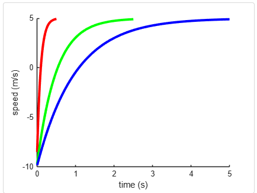

# Control-Systems-Lab me

## Lab Status: In Progress

This learning lab explores the modeling and simulation of dynamic systems using MATLAB. Current work includes first-order system responses, spring-mass-damper modeling, numerical integration using Euler methods, and comparisons with continuous-time transfer-function simulations.
The next phase will focus on poles, system stability, and feedback control.
The goal is to build a stronger understanding of control systems through mathematical modeling, simulation, and experimentation.

## First-Order Speed Response Simulation

This project is simulating a first order ODE system designed to showcase a system response to meeting a user desired speed. The system response was produced using a forward Euler integration. Due to the use of such a numerical method, it’s an approximation of the system’s exact continuous-time response. The purpose of this simple simulation is to understand the effects of factors like that delta time (dt) and the time constant (tau) and how they affect a system’s response.

### Mathematical Model

The system is described by the following first-order differential equation:

```math
\frac{dx}{dt} = \frac{u-x}{\tau}
```

Where:

`u` is the desired speed

`x` is the current speed

`tau` is the time constant

The time constant determines how quickly the system approaches its desired speed. A smaller time constant produces a faster response, while a larger time constant produces a slower response.

### Implementation

The simulation uses Forward Euler integration to approximate the speed response over discrete time steps.

Numerical update equation:

```math
x_{n+1} = x_n + \frac{u - x_n}{\tau} * dt
```
This was implemented in MATLAB using:

```matlab
deriv = (u - x) / tau;
x = x + deriv * dt;
```

At each iteration, the current rate of change is calculated using the difference between the desired and current speeds. This rate is assumed constant over the time step and used to estimate the next speed.

The updated speed values are stored in an array and plotted against time.

**The project consists of two MATLAB files:**

compare_sim.m – Runs experiments with different time constants and plots the results.

simulateFirstOrderSpeed.m – Numerically calculates the speed response using Forward Euler integration.

### Experiment – Effect of the Time Constant

The simulation was run three times with the same initial parameters with the exception being the value of the time constant itself.

(RED) => `tau` = 0.1;

(GREEN) => `tau` = 0.5;

(BLUE) => `tau` = 1;

### Results



As shown by the fact that the red simulation reached the desired value of 5 m/s the fastest, while the blue simulation reached it the latest, it’s confirmed that a smaller time constant produces a faster response.

### Key Takeaways

A smaller time constant produces a faster response. I also noticed that the reciprocal of the time constant scales the error term, which resembles how proportional gain affects a controller's response.  Another subtly that I learned was that this system is only an approximation to which its accuracy varies on the magnitude of the time steps. As for each time step the system is assuming a constant rate of change over each time step when in reality that may not be the case.


